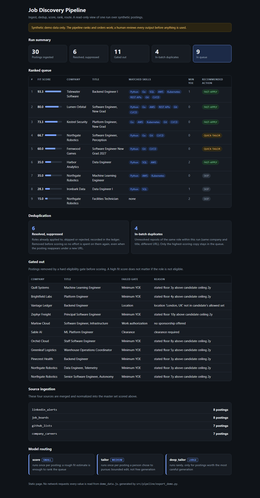

# Job Discovery and Ranking Pipeline

**[Live dashboard](https://ruhinpatel.github.io/job-discovery-pipeline/)**

Job postings arrive from many sources, and most of them are duplicates, reposts, or roles the candidate is not eligible for. A person can only act on a handful per day. This pipeline collects postings from several sources, normalizes them into one schema, removes roles that are already resolved, applies hard eligibility gates, scores what is left against a fit rubric, routes each row to an effort lane, and hands a short ranked queue to a human to review. The pipeline orders the work, and a person decides what to do with it.

> **The demo runs on 30 synthetic postings. Human-in-the-loop: all outputs are reviewed by a person before use.** The default run makes no network calls. An optional, opt-in live adapter can fetch real postings from a public Greenhouse board (see [Use it on your own data](#use-it-on-your-own-data)). No production usage is claimed.



**The funnel on the demo data:** 30 ingested -> 6 resolved-suppressed -> 11 gated out -> 4 in-batch duplicates collapsed -> 9 ranked and lane-routed for human review.

## Quickstart

```
pip install -r requirements.txt
PYTHONPATH=src python src/pipeline/candidate_queue.py
PYTHONPATH=src python -m pytest -q
```

`PYTHONPATH=src` is required for the raw-script commands because the package lives under `src/`. Installing it (`pip install .`, or `pip install -e .` while developing) removes that requirement and gives you the `jobpipe` and `jobpipe-ingest` commands.
Real output of the queue command (table trimmed to the first 5 of the 9 queued rows; the full run lists all 9, then the gated-out summary):

```
30 postings | 6 resolved-suppressed | 11 gated | 4 in-batch duplicates | 9 in queue

 #  Score  Lane           Company            Title                          Matched skills                                               Why
 1   93.3  1 FAST-APPLY   Tidewater Software Backend Engineer I             8 (Python, Go, SQL, AWS, Kubernetes, REST APIs, Git, CI/CD)  score 93.3 at or above 70
 2   80.0  1 FAST-APPLY   Lumen Orbital      Software Engineer, New Grad    6 (Python, Go, AWS, REST APIs, Git, CI/CD)                   referral bypasses the keyword screen
 3   73.3  1 FAST-APPLY   Kestrel Security   Platform Engineer, New Grad    5 (Go, AWS, Kubernetes, Git, CI/CD)                          score 73.3 at or above 70
 4   66.7  2 QUICK-TAILOR Northgate Robotics Software Engineer, Perception  4 (Python, Go, Git, CI/CD)                                   score 66.7 in the 60-70 band where a short t...
 5   60.0  2 QUICK-TAILOR Fernwood Games     Software Engineer New Grad 2027 3 (Python, Git, CI/CD)                                       score 60 in the 60-70 band where a short tai...
...
Gated out: 1 clearance, 1 location, 8 min_yoe, 1 work_authorization
```


## Architecture

```text
  Sources (4 adapters)      linkedin_alerts, job_boards, github_lists, company_careers
          |
          v
  Normalization             map each source's shape to one canonical posting schema
          |
          v
  Dedup ledger              drop roles already resolved (company|title fingerprint)
          |
          v
  Hard gates                remove ineligible rows (YOE, work auth, clearance, location)
          |
          v
  Fit scorer                weighted rubric -> 0-100 score (deterministic, optional LLM)
          |
          v
  Lane routing              SKIP / FAST-APPLY / QUICK-TAILOR / DEEP-TAILOR
          |
          v
  Ranked queue
          |
          v
  [ Human review gate ]     a person decides; nothing downstream runs automatically
```

The pipeline orders the work up to the ranked queue; the final gate is a person, not code.

### Optional: LLM scoring

By default scoring is deterministic and offline. To score with an LLM instead, run `pip install -r requirements-llm.txt` and set `JOBPIPE_LLM=1` plus `ANTHROPIC_API_KEY`; the router's cheap tier is used. Posting text is treated as untrusted data (delimited, with the model told to ignore embedded instructions), and any API or parse failure falls back to the deterministic scorer.

## Source adapters (sources + normalization)

`src/pipeline/adapters/` isolates each discovery source behind a small `SourceAdapter` subclass. There are four: `linkedin_alerts`, `job_boards`, `github_lists`, and `company_careers`. Each reads a committed synthetic raw fixture from `data/raw/`, and each fixture has a deliberately different shape (alert-digest JSON, ATS-board JSON, a curated-list CSV, a career-page JSON feed). Each adapter's `normalize` step maps its shape to one canonical posting schema (`company`, `title`, `url`, `description`, `min_years_experience`), including source-specific handling such as deriving a years-of-experience floor from free text or metadata. `ingest.run_all_adapters()` merges the four normalized outputs into one list, so everything downstream sees a single shape and adding a source means adding one adapter. The four default adapters read fixtures only, so the default run makes no network calls and uses no real postings. The one exception is the separate, opt-in `GreenhouseLiveAdapter` (`adapters/greenhouse_live.py`), which is deliberately not part of the default set and is only used when you pass `--live-greenhouse`.

The adapters are the single origin of the demo data. `data/postings.csv`, the master set the queue scores, is a generated snapshot of the merged adapter output (adapter order, each adapter's record order preserved, reposts kept so the queue's dedup has real work to do), not a hand-maintained file. To change the demo data, edit the raw fixtures in `data/raw/` and regenerate with `--write`; because the master is the adapters' output, the dashboard's per-source counts always sum to its "Postings ingested" total.

```
python src/pipeline/adapters/ingest.py          # per-source counts
python src/pipeline/adapters/ingest.py --write  # regenerate data/postings.csv
```

## Dedup / resolved-roles ledger

`src/pipeline/ledger.py` keeps a CSV ledger of roles that have already been resolved, so they are not surfaced again. Identity is a normalized `company|title` fingerprint (lowercased, punctuation, year and cohort words removed), so one role reposted at many URLs collapses to a single entry. Matching is exact after normalization, never fuzzy. The ledger holds one row per fingerprint; re-resolving a role refreshes that row in place.

## Fit-scoring rubric and cost-aware model routing

`src/pipeline/scorer.py` scores each posting against a candidate profile using a weighted rubric (skill overlap, role-title match, seniority fit) and returns a 0-100 score with a visible breakdown, so a reviewer can see why a row ranked where it did instead of trusting an opaque number. The real system scores with an LLM call; this public version swaps that call for a deterministic keyword/skill-overlap scorer against a synthetic candidate-profile fixture (`data/profile.json`), so the demo makes no API calls and uses no real data.

`src/pipeline/router.py` holds the routing decision that motivates scoring this way at all: high-frequency, low-stakes work (scoring every posting) routes to the cheapest model tier; low-frequency, higher-stakes work (tailoring content for a posting a person actually chose to pursue) routes to a larger tier. The policy is plain data (`TASK_TIERS`), separate from the scoring logic, so it can be inspected or changed without touching `scorer.py`.

## Candidate queue

`src/pipeline/candidate_queue.py` consumes the ledger and the scorer end to end: it loads postings, drops any whose fingerprint is already resolved, scores the survivors, and ranks them by fit. It also collapses within-batch duplicates: two unresolved reposts of the same role (same fingerprint, different URL) reduce to the single highest-scoring row, with ties keeping the first in input order. It returns the ranked queue together with the ledger-suppressed postings and the collapsed in-batch duplicates, each with its own count, so a reviewer can see how much repeat work was removed and why. The queue orders the work; a person still decides what to do with each row.

```
python src/pipeline/candidate_queue.py
```

The output header reports postings, resolved-suppressed, gated-out (failed a hard eligibility gate), in-batch duplicates, and the final queue size; the four removed-or-kept figures always reconcile to the total: resolved-suppressed + gated + in-batch duplicates + in queue = postings (in the demo, 6 + 11 + 4 + 9 = 30). The demo master set, generated by the adapters, is built to exercise every path: some roles match the resolved ledger and are suppressed, some are reposts (including one that appears in two different sources) and collapse to the best-scoring row, and the rest are ranked from strong backend/infrastructure fits down to off-target and over-senior roles.

Synthetic fixtures live in `data/`.

## Decision layer (hard gates + lane routing)

`src/pipeline/gates.py` runs hard eligibility gates before any posting is scored: a minimum years-of-experience floor, work authorization, clearance requirements, and location. A failed gate removes the posting regardless of how well it matches, because the scorer answers how good a fit a role is and the gate answers whether it is eligible at all. Gated postings are reported separately with the gate that removed them and a plain-language reason, so a reviewer can see what was excluded and why.

`src/pipeline/lanes.py` gives each surviving row a lane that recommends how much effort it earns: SKIP (failed gate, or a score too low to reach the keyword-match threshold with no referral), FAST-APPLY (no tailoring, submit now), QUICK-TAILOR (a short targeted edit in the band where it can realistically cross that threshold), and DEEP-TAILOR (reserved for postings a person picks deliberately, never assigned automatically). A referral routes a row to FAST-APPLY even below the keyword-match threshold, because a referral bypasses the keyword screen entirely. Each lane carries a `model_task` that maps to `router.py`: the lane decides how much effort a row gets, and the router decides which model tier performs that work.

The thresholds (`LANE_SKIP_BELOW=60`, `LANE_FAST_APPLY_MIN=70`) originate from a resume-versus-job-description keyword-match cliff, but in this public demo `score` is a profile-fit score from the scorer's rubric, not a keyword-match percentage, so the demo reuses those 60 and 70 bands as stand-in thresholds against the fit score.

## Use it on your own data

The demo reads committed synthetic files. To run it on your own search:

**1. Install.**

```
pip install .            # or: pipx install .
```

This provides `jobpipe` (rank a queue) and `jobpipe-ingest` (regenerate the demo postings). There are no runtime dependencies.

**2. Describe yourself.** Copy `data/profile.example.json` to your own folder and edit it. Every field is used by the gates or the scorer:

```json
{
  "name": "Your Name",
  "role_preferences": ["Software Engineer", "Backend Engineer"],
  "skills": ["Python", "SQL", "AWS"],
  "min_years_experience": 0,
  "max_years_experience": 2,
  "allowed_locations": ["Remote - US", "New York, NY"],
  "needs_sponsorship": true,
  "can_obtain_clearance": false
}
```

A posting listing several places (`A | B` or `A; B`) passes the location gate if any one of them is in `allowed_locations`.

**3. Point the tool at your data.** Paths resolve as command-line flag, then environment variable, then the default folder (`data/` in a source checkout, otherwise `./data`):

| What | Flag | Environment variable |
|---|---|---|
| Data folder (`postings.csv`, `resolved_roles.csv`) | `--data-dir` | `JOBPIPE_DATA_DIR` |
| Profile file | `--profile` | `JOBPIPE_PROFILE` |

**4. Fetch real postings (optional, uses the network).** Give it one or more public Greenhouse board tokens (the `x` in `boards.greenhouse.io/x`):

```
jobpipe --profile my_profile.json --live-greenhouse anthropic stripe
```

This calls the public, no-auth board API with a generic User-Agent, writes `<data-dir>/postings_live.csv` (the demo `postings.csv` is never overwritten), and ranks it. A board that fails to load is skipped. To track roles you have already handled, add rows to `resolved_roles.csv` in your data folder so reposts do not resurface.

**Known limitations on real data.** These are real, not hypothetical:

- **Greenhouse only.** The other adapters still read synthetic fixtures; there is no live LinkedIn, GitHub-list, or career-page fetching.
- **Sponsorship is unknown.** Public boards expose no sponsorship flag, so every live row defaults to "sponsorship offered". The work-authorization gate cannot screen live rows; check each posting yourself.
- **Seniority is read from the text, not the title.** The experience gate uses a stated "N years" figure. A Staff or Principal role whose posting states no number reads as 0 years and passes, so senior roles can rank high for an early-career profile.
- **Fit scoring is keyword overlap**, a stand-in for the LLM scorer, so treat the score as a sort order and not a judgment.

## Running the tests

```
pip install -e ".[dev]"
python -m pytest -q
```


