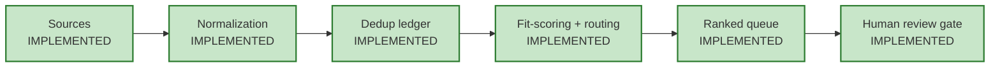

# Job Discovery and Ranking Pipeline

A pipeline that collects job postings from multiple sources, normalizes them, removes duplicates (including the same role reposted at different URLs), ranks the remainder against a fit-scoring rubric, and presents a ranked queue for a person to review. It is built around human review: the pipeline orders the work, and a person decides what to do with it.

> **Runs on a synthetic demo dataset. Human-in-the-loop: all outputs are reviewed by a person before use.**

## Architecture



### Implemented: source adapters (sources + normalization)

`src/pipeline/adapters/` isolates each discovery source behind a small `SourceAdapter` subclass. There are four: `linkedin_alerts`, `job_boards`, `github_lists`, and `company_careers`. Each reads a committed synthetic raw fixture from `data/raw/`, and each fixture has a deliberately different shape (alert-digest JSON, ATS-board JSON, a curated-list CSV, a career-page JSON feed). Each adapter's `normalize` step maps its shape to one canonical posting schema (`company`, `title`, `url`, `description`, `min_years_experience`), including source-specific handling such as deriving a years-of-experience floor from free text or metadata. `ingest.run_all_adapters()` merges the four normalized outputs into one list, so everything downstream sees a single shape and adding a source means adding one adapter. In production `fetch_raw` would call live APIs or parse alert emails; here it reads fixtures only, so there are no network calls and no real postings.

The adapters are the single origin of the demo data. `data/postings.csv`, the master set the queue scores, is a generated snapshot of the merged adapter output (adapter order, each adapter's record order preserved, reposts kept so the queue's dedup has real work to do), not a hand-maintained file. To change the demo data, edit the raw fixtures in `data/raw/` and regenerate with `--write`; because the master is the adapters' output, the dashboard's per-source counts always sum to its "Postings ingested" total.

```
python src/pipeline/adapters/ingest.py          # per-source counts
python src/pipeline/adapters/ingest.py --write  # regenerate data/postings.csv
```

### Implemented: dedup / resolved-roles ledger

`src/pipeline/ledger.py` keeps a CSV ledger of roles that have already been resolved, so they are not surfaced again. Identity is a normalized `company|title` fingerprint (lowercased, punctuation, year and cohort words removed), so one role reposted at many URLs collapses to a single entry. Matching is exact after normalization, never fuzzy. The ledger holds one row per fingerprint; re-resolving a role refreshes that row in place.

### Implemented: fit-scoring rubric + cost-aware model routing

`src/pipeline/scorer.py` scores each posting against a candidate profile using a weighted rubric (skill overlap, role-title match, seniority fit) and returns a 0-100 score with a visible breakdown, so a reviewer can see why a row ranked where it did instead of trusting an opaque number. The real system scores with an LLM call; this public version swaps that call for a deterministic keyword/skill-overlap scorer against a synthetic candidate-profile fixture (`data/profile.json`), so the demo makes no API calls and uses no real data.

`src/pipeline/router.py` holds the routing decision that motivates scoring this way at all: high-frequency, low-stakes work (scoring every posting) routes to the cheapest model tier; low-frequency, higher-stakes work (tailoring content for a posting a person actually chose to pursue) routes to a larger tier. The policy is plain data (`TASK_TIERS`), separate from the scoring logic, so it can be inspected or changed without touching `scorer.py`.

### Implemented: candidate queue

`src/pipeline/candidate_queue.py` consumes the ledger and the scorer end to end: it loads postings, drops any whose fingerprint is already resolved, scores the survivors, and ranks them by fit. It also collapses within-batch duplicates: two unresolved reposts of the same role (same fingerprint, different URL) reduce to the single highest-scoring row, with ties keeping the first in input order. It returns the ranked queue together with the ledger-suppressed postings and the collapsed in-batch duplicates, each with its own count, so a reviewer can see how much repeat work was removed and why. The queue orders the work; a person still decides what to do with each row.

```
python src/pipeline/candidate_queue.py
```

The output header reports postings, resolved-suppressed, in-batch duplicates, and the final queue size; those three figures always reconcile to the total. The demo master set, generated by the adapters, is built to exercise every path: some roles match the resolved ledger and are suppressed, some are reposts (including one that appears in two different sources) and collapse to the best-scoring row, and the rest are ranked from strong backend/infrastructure fits down to off-target and over-senior roles.

Synthetic fixtures live in `data/`.

## Running the tests

```
pip install -r requirements.txt
pytest
```
