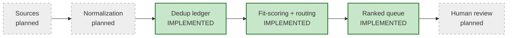

# Job Discovery and Ranking Pipeline

A pipeline that collects job postings from multiple sources, normalizes them, removes duplicates (including the same role reposted at different URLs), ranks the remainder against a fit-scoring rubric, and presents a ranked queue for a person to review. It is built around human review: the pipeline orders the work, and a person decides what to do with it.

> **Runs on a synthetic demo dataset. Human-in-the-loop: all outputs are reviewed by a person before use.**

## Architecture



### Implemented: dedup / resolved-roles ledger

`src/pipeline/ledger.py` keeps a CSV ledger of roles that have already been resolved, so they are not surfaced again. Identity is a normalized `company|title` fingerprint (lowercased, punctuation, year and cohort words removed), so one role reposted at many URLs collapses to a single entry. Matching is exact after normalization, never fuzzy. The ledger holds one row per fingerprint; re-resolving a role refreshes that row in place.

### Implemented: fit-scoring rubric + cost-aware model routing

`src/pipeline/scorer.py` scores each posting against a candidate profile using a weighted rubric (skill overlap, role-title match, seniority fit) and returns a 0-100 score with a visible breakdown, so a reviewer can see why a row ranked where it did instead of trusting an opaque number. The real system scores with an LLM call; this public version swaps that call for a deterministic keyword/skill-overlap scorer against a synthetic candidate-profile fixture (`data/profile.json`), so the demo makes no API calls and uses no real data.

`src/pipeline/router.py` holds the routing decision that motivates scoring this way at all: high-frequency, low-stakes work (scoring every posting) routes to the cheapest model tier; low-frequency, higher-stakes work (tailoring content for a posting a person actually chose to pursue) routes to a larger tier. The policy is plain data (`TASK_TIERS`), separate from the scoring logic, so it can be inspected or changed without touching `scorer.py`.

### Implemented: candidate queue

`src/pipeline/candidate_queue.py` consumes the ledger and the scorer end to end: it loads postings, drops any whose fingerprint is already resolved, scores the survivors, and ranks them by fit. It returns the ranked queue together with the suppressed postings and their count, so a reviewer can see how much repeat work the ledger removed. The queue orders the work; a person still decides what to do with each row.

```
python src/pipeline/candidate_queue.py
```

In the demo data, 4 of 5 postings are suppressed (both reposted Acme URLs share one fingerprint, plus the already-resolved Northwind and Globex roles) and one remains in the queue.

Synthetic fixtures live in `data/`.

## Running the tests

```
pip install -r requirements.txt
pytest
```
